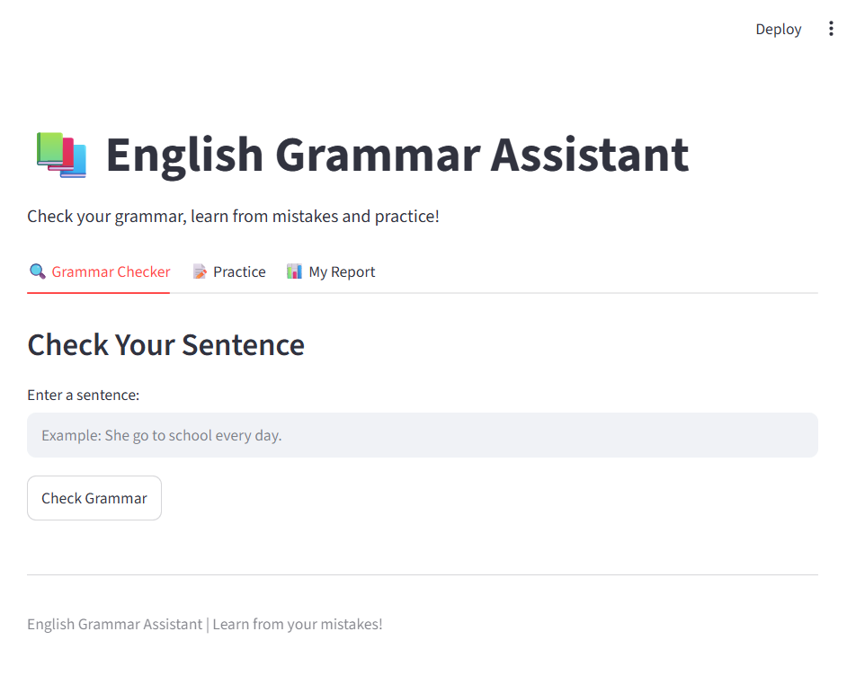
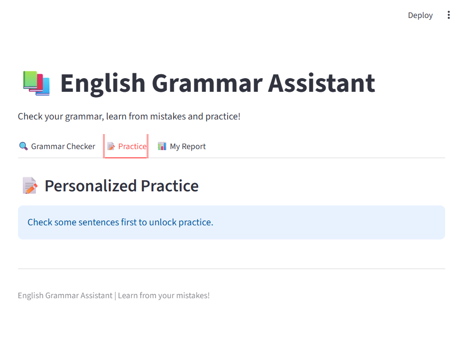
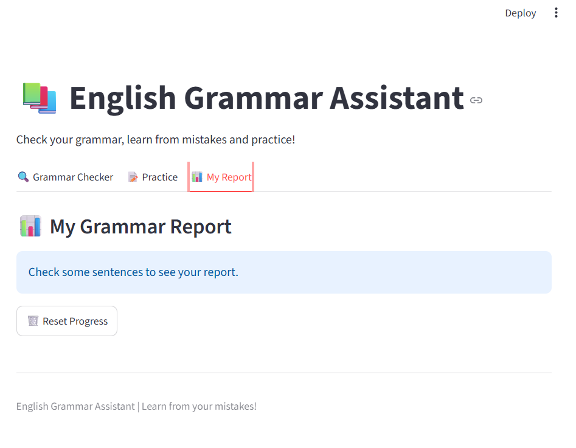
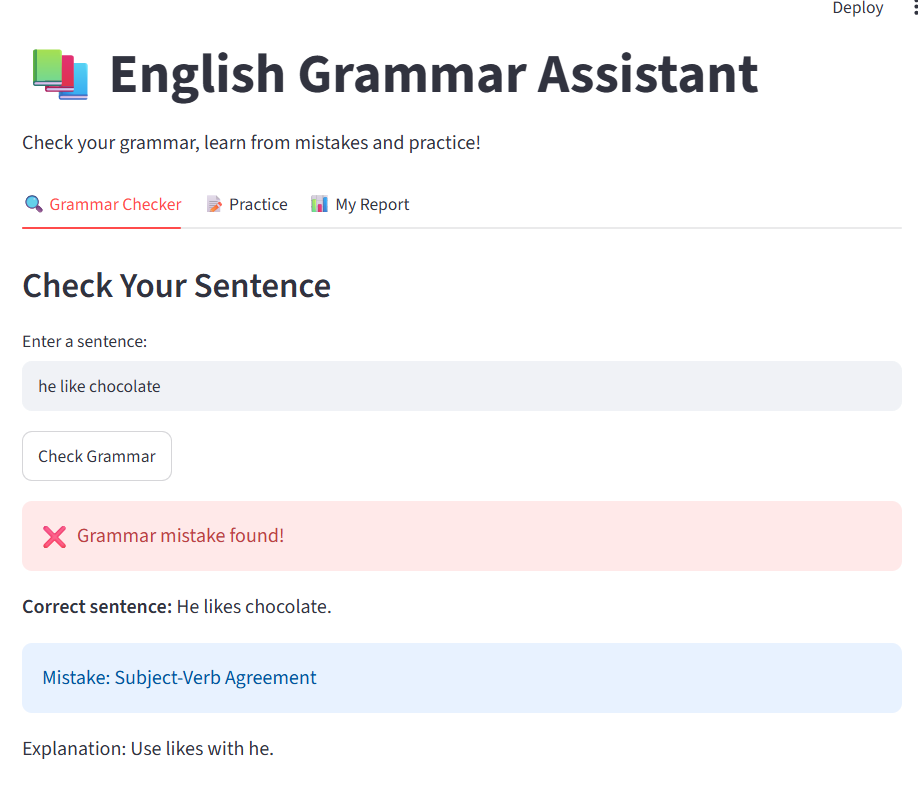
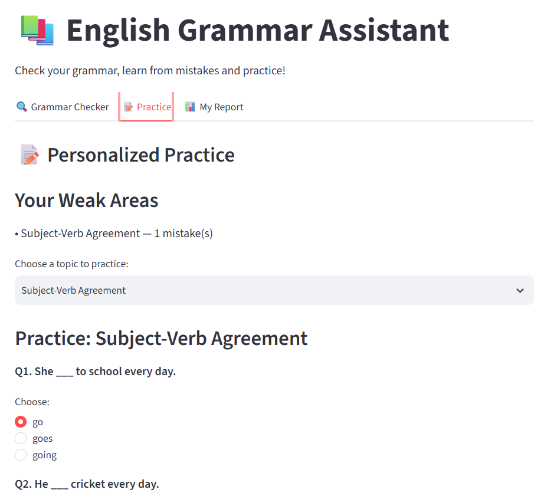

# 📚 English Grammar Assistant

A simple and interactive grammar learning application built using Python and Streamlit.

The project checks common grammar mistakes, shows the correct sentence with an explanation, remembers the user's mistakes, and provides personalized practice based on the user's weak areas.

## 🎯 Project Objective

The main aim of this project is to help users improve their English grammar by:

- Identifying common grammar mistakes
- Showing the corrected sentence
- Explaining the mistake in simple words
- Remembering the user's common mistakes
- Providing practice questions based on weak areas
- Showing a simple grammar progress report

## ✨ Features

### 🔍 Grammar Checker

The user enters a sentence and the system checks it against the grammar dataset.

It provides:
- Correct sentence
- Mistake type
- Simple explanation

### 📝 Personalized Practice

The system remembers the grammar mistakes made by the user.

The Practice section automatically updates when a new mistake appears.

The user can select a specific weak area and practice questions related to that topic.

Current practice topics include:
- Subject-Verb Agreement
- Tense
- Articles
- Common Word Mistake

### 📊 Grammar Report

The report shows:
- Grammar score
- Number of sentences checked
- Total mistakes
- Mistake history

### 🧠 Personalized Mistake Memory

One of the main features of the project is that it remembers the user's mistake categories.

This helps the user focus on the areas where they need more practice.







## 🛠️ Technologies Used

- Python
- Streamlit
- Pandas
- CSV Dataset

## 📂 Project Structure

```text
English-Grammar-Assistant/
│
├── app.py
├── grammar_data.csv
├── README.md
└── screenshots/
    ├── pic1.png
    ├── pic2.png
    ├── pic3.png
    ├── pic4.png
    └── pic5.png
```

## ⚙️ How It Works

```text
User enters sentence
        ↓
Grammar Checker
        ↓
Mistake identified
        ↓
Correction + Explanation
        ↓
Mistake is remembered
        ↓
Weak area appears in Practice
        ↓
User practices the topic
        ↓
Grammar Report is updated
```

## 📊 Current Dataset

The current prototype uses a small predefined dataset containing common grammar mistakes and their corrections.

The dataset includes categories such as:

- Subject-Verb Agreement
- Tense
- Articles
- Common Word Mistake

## 🚀 How to Run

### 1. Install the required libraries

```bash
pip install streamlit pandas
```

### 2. Run the application

Open the project folder in the terminal and run:

```bash
python -m streamlit run app.py
```

The application will open in the browser.

## 💡 What Makes This Project Different?

Many existing grammar tools mainly focus on correcting the user's sentence.

This project focuses on learning from mistakes.

It remembers the user's common grammar mistake categories and automatically updates the Practice section so the user can practice their weak areas.

## ⚠️ Current Limitations

The current prototype checks sentences that are available in its predefined grammar dataset.

It is not yet a full NLP-based grammar correction system and cannot understand every possible English sentence.

## 🔮 Future Enhancements

The project can be improved by:

- Supporting any sentence instead of only predefined examples
- Using a larger grammar dataset
- Integrating an NLP-based grammar correction model or API
- Adding more grammar categories
- Providing more advanced progress tracking
- Adding user accounts and long-term progress storage

## 👩‍💻 Project

**English Grammar Assistant**

Built as a simple academic project to demonstrate grammar checking, mistake tracking, and personalized learning using Python and Streamlit.
